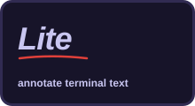

# herdr-annotate
Annotate inside [Herdr](https://github.com/herdrdev/herdr): comment on any terminal text, review whole Markdown documents and your agent's replies, and send the feedback straight back to the agent. Document review is powered by [plannotator-tui](https://github.com/plannotator/plannotator-tui), which also runs on its own outside Herdr.

<p align="center">
  <a href="https://github.com/backnotprop/plannotator">
    
  </a>
</p>

**Watch the demos**

[](https://x.com/plannotator/status/2093419561077154287)
[](https://x.com/plannotator/status/2092757422322627008)

## Requirements

- Herdr 0.8.0 or later
- macOS, Linux, or Windows

There is no runtime to install. Both installs download a small prebuilt `herdr-annotate` binary and verify its SHA-256 checksum.

On Linux, install `wl-clipboard`, `xclip`, or `xsel` for clipboard access.

On Windows, native Herdr plugin support is preview/best-effort. Lite installs on Herdr 0.8.0 or later; Full installs through the Windows Full variant below, which needs Herdr 0.9.0 or later. Clipboard access uses PowerShell; no extra clipboard package is required. The install, keybinding, configuration check, reload, and use instructions below also apply on Windows.

## Install

Pick one. Installing another later just swaps it (same plugin id). An install stays on the commit it came from; run the same command again to move to the current release.


**Full:** annotate terminal text, review documents and agent replies, send feedback to the agent.
Wraps [Plannotator TUI](https://github.com/plannotator/plannotator-tui) (macOS and Linux; Windows via the windows-full variant below). [Demo](https://x.com/plannotator/status/2093419561077154287)

```sh
herdr plugin install plannotator/herdr-annotate
```

<br clear="all">



**Lite:** the simple version: select text, `prefix+a`, comment in a popover. [Demo](https://x.com/plannotator/status/2092757422322627008)

```sh
herdr plugin install plannotator/herdr-annotate/lite
```

<br clear="all">

**Windows Full (preview):** the Full install on Windows, opt-in. Requires Herdr 0.9.0 or later on Windows.

```sh
herdr plugin install plannotator/herdr-annotate/windows-full
```

It stages `plannotator-tui` natively, so no launcher sits between Herdr and the TUI. It shares the same native runtime as the Lite and Full installs, so annotations and archives stay in one place.

This is a preview. The pane and path handling were verified on Windows 11 x86_64 ([PR #49](https://github.com/plannotator/herdr-annotate/pull/49), [issue #43](https://github.com/plannotator/herdr-annotate/issues/43)). Native ARM64 is untested. Report results on [issue #43](https://github.com/plannotator/herdr-annotate/issues/43).

> **Required.** Bind the keys in Herdr's config. These keys are free in Herdr's defaults; if you changed yours, check for clashes with `herdr --default-config` and your own config.

<details open>
<summary><b>Full install keys:</b> terminal annotations + document and agent-reply review</summary>

```toml
# Terminal annotations
[[keys.command]]
key = "prefix+a"
type = "plugin_action"
command = "annotate.capture"
description = "annotate text"

[[keys.command]]
key = "prefix+shift+a"
type = "plugin_action"
command = "annotate.copy-context"
description = "copy annotations as context"

[[keys.command]]
key = "prefix+ctrl+a"
type = "plugin_action"
command = "annotate.copy-archive"
description = "copy annotations as context and archive them"

[[keys.command]]
key = "prefix+ctrl+v"
type = "plugin_action"
command = "annotate.paste-archive"
description = "paste annotations into the agent's prompt and archive them"

[[keys.command]]
key = "prefix+ctrl+s"
type = "plugin_action"
command = "annotate.send-archive"
description = "send annotations to the agent and archive them"

[[keys.command]]
key = "prefix+m"
type = "plugin_action"
command = "annotate.manage"
description = "manage annotations"

# Document review (plannotator-tui)
[[keys.command]]
key = "prefix+d"
type = "plugin_action"
command = "annotate.open"
description = "review documents in this folder"

[[keys.command]]
key = "prefix+shift+o"
type = "plugin_action"
command = "annotate.last"
description = "review the agent's last reply"

[[keys.command]]
key = "prefix+ctrl+o"
type = "plugin_action"
command = "annotate.last-newest"
description = "review the agent's newest reply"
```

</details>

<details>
<summary><b>Lite install keys:</b> terminal annotations only</summary>

```toml
[[keys.command]]
key = "prefix+a"
type = "plugin_action"
command = "annotate.capture"
description = "annotate text"

[[keys.command]]
key = "prefix+shift+a"
type = "plugin_action"
command = "annotate.copy-context"
description = "copy annotations as context"

[[keys.command]]
key = "prefix+ctrl+a"
type = "plugin_action"
command = "annotate.copy-archive"
description = "copy annotations as context and archive them"

[[keys.command]]
key = "prefix+ctrl+v"
type = "plugin_action"
command = "annotate.paste-archive"
description = "paste annotations into the agent's prompt and archive them"

[[keys.command]]
key = "prefix+ctrl+s"
type = "plugin_action"
command = "annotate.send-archive"
description = "send annotations to the agent and archive them"

[[keys.command]]
key = "prefix+m"
type = "plugin_action"
command = "annotate.manage"
description = "manage annotations"
```

</details>

Check and reload:

```sh
herdr config check
herdr server reload-config
```

## Use

### Annotate terminal text

| Key | Action |
|---|---|
| `Ctrl+B A` | comment on the selected text · `Ctrl+S` saves |
| `Ctrl+B Shift+A` | copy all annotations as Markdown |
| `Ctrl+B Ctrl+A` | copy all annotations as Markdown, then archive them |
| `Ctrl+B Ctrl+V` | paste all annotations into the focused agent's prompt without sending, then archive them |
| `Ctrl+B Ctrl+S` | send all annotations as the focused agent's next message, then archive them |
| `Ctrl+B M` | manage · `Enter` jump to the pane it came from · `e` edit the selected comment · `y` copy one · `c` copy all · `Shift+C` copy and archive · `Tab` archives (`y` copy · `u` restore · `d d` delete) |

In the manager's active view, `e` opens the selected comment in the editor. `Ctrl+S` saves it;
`Esc` cancels. Editing leaves the selected text, capture metadata, and original ordering unchanged.
If another pane saves that comment first, saving your stale draft is rejected and the draft stays
open. To edit the latest version, cancel with `Esc`, then press `r` in the manager to reload.

`Enter` focuses the Herdr pane the selected annotation was captured from and closes the manager.
Agent panes are focused directly; for any other pane, Herdr focuses the tab that holds it. If the
pane has closed, or the annotation has no pane recorded, the manager says so and stays open. Herdr
cannot scroll a pane to the annotated text, so the jump stops at the pane.

Annotations are listed and handed off oldest first, in the order you wrote them, so the agent
reads your feedback in the same order you went through the text. The Markdown uses Plannotator's
feedback format: one numbered `## Annotation N` per note, headed with the workspace and tab it came
from, then `Comment on:` with the selected text and your comment as a `>` quote.

Copies made inside the manager pane also emit OSC 52, so on Herdr 0.9.0 they reach the clipboard of
the machine you are viewing from even when the plugin runs on a remote server with no clipboard tool
installed; `Ctrl+B Shift+A` and `Ctrl+B Ctrl+A` do not, because those actions run outside a pane and
have no terminal to write to.

`Ctrl+B Ctrl+V` and `Ctrl+B Ctrl+S` skip the clipboard and put the same Markdown straight into the
prompt of the agent in the focused pane. Both first ask Herdr whether the agent is ready. When
that pane has no running agent Herdr recognises, the agent is still launching, or it is waiting at
an approval or question prompt, they refuse, type nothing, and leave your annotations active.

### Review documents and agent replies

Full install. Works with Claude Code, Codex, pi, Copilot CLI, Droid, Oh My Pi, Hermes CLI, OpenCode (1 and 2), Command Code and Antigravity CLI.

| Key | Opens |
|---|---|
| `Ctrl+B O` | this folder, with a file tree |
| `Ctrl+B Shift+O` | the agent's recent replies |
| `Ctrl+B Ctrl+O` | the agent's newest reply, with no picker |
| Ctrl-click a `file://…md` link | that file, only with the opt-in Links add-on below |

`annotate.terminal` opens the focused pane's recent terminal output (the last 200 lines) for
review in the same way. It has no default key; to use it, bind one yourself, for example:

```toml
[[keys.command]]
key = "prefix+t"
type = "plugin_action"
command = "annotate.terminal"
description = "review this pane's recent output"
```

`annotate.review` opens a code review of the focused pane's git changes. Comment on lines of
the diff, then send the comments to the agent in that pane. A folder with no repository or no
changes shows an error instead. It works on macOS and Linux, and has no default key:

```toml
[[keys.command]]
key = "prefix+ctrl+r"
type = "plugin_action"
command = "annotate.review"
description = "review this repo's changes"
```

`annotate.gate` opens the same folder review as `annotate.open`, with an **Approve** button
(`A`). The agent gets `The user approved.` (with any notes as non-blocking guidance), or your
numbered feedback as usual. Use it when an agent should wait for your sign-off. It has no
default key either:

```toml
[[keys.command]]
key = "prefix+ctrl+d"
type = "plugin_action"
command = "annotate.gate"
description = "review documents here, with Approve"
```

#### Ctrl-click Markdown links (opt-in)

Annotate does not capture Ctrl-click on links by default, so `file://…md` links open the way
Herdr normally opens them. To send Ctrl-clicked `file://` Markdown links (`.md`, `.markdown`,
`.mdx`) to Annotate instead, install the Links add-on next to the Full install (on Windows, next
to Windows Full):

```sh
herdr plugin install plannotator/herdr-annotate/links
```

To turn it off again:

```sh
herdr plugin uninstall annotate-links
```

The add-on has no binary of its own; it opens the file with the Full (or Windows Full) plugin's
plannotator-tui. If neither is installed, Ctrl-click shows a notification saying which one to install.

> **Upgrading from 0.8.0 or earlier:** up to plugin 0.8.0, the Full install captured these clicks
> itself. From 0.9.0 it does not
> ([#69](https://github.com/plannotator/herdr-annotate/issues/69)). Install the Links add-on to keep
> the old behavior.

**Send** (or `E`) makes the review the agent's next message. `q` closes. On an agent reply, `S`
sends and closes in one key; `E` and `q` are unchanged.

| Option | Where |
|---|---|
| Agents request reviews themselves | `npx skills add plannotator/herdr-annotate --skill plannotator-tui -g` |
| Open as full tab, split, or popup | `[herdr] placement = "overlay" \| "split" \| "popup"` in `~/.config/plannotator-tui/config.toml` |
| Use without Herdr | [plannotator-tui](https://github.com/plannotator/plannotator-tui) |

### Remote sessions

Over SSH or `herdr --remote`, the plugin runs on the **server**. It gets the text only when
Herdr passes the selection to the action, because a headless server has no clipboard to fall
back to. On Herdr 0.9.5:

| Selection | `prefix+a` | `herdr plugin action invoke annotate.capture` |
|---|---|---|
| Copy mode (`prefix+[`, `v`, move) | Works | No text |
| Mouse drag | No text: the prefix keypress clears the selection ([herdrdev/herdr#3380](https://github.com/herdrdev/herdr/issues/3380)) | No text |

So on a remote server:

1. Select in copy mode: `prefix+[`, move to the start, `v`, move to the end, then `prefix+a`.
   The comment dialog opens with the selection. You do not need to leave copy mode first.

2. In Neovim, use the [mapping below](#neovim-integration). It puts the selection in the
   request it sends to Herdr, so no clipboard or file is involved.

Since Herdr 0.9.0 the selection is held by the attached client, not the server, so
`herdr plugin action invoke` from a shell or from `ssh <host>` no longer sees it. The old
`ssh <host> herdr plugin action invoke annotate.capture` workaround only works on Herdr 0.8.2
and earlier.

Server-side key bindings and `herdr --remote <host> --remote-keybindings server` are still
needed for `prefix+a`, the manager (`prefix+m`), and other plugin keys; without the flag,
`herdr --remote` uses your local keys and drops plugin bindings.

## Selection limits

Herdr Annotate uses the selection that Herdr passes to the action. When Herdr passes none, it reads the system clipboard. The plugin cannot read selection state from Neovim or another terminal application by itself; the [Neovim mapping](#neovim-integration) sends the selection for it.

## Development

The plugin is a Rust binary in `rust/`.

```sh
cargo test --manifest-path rust/Cargo.toml
cargo clippy --manifest-path rust/Cargo.toml --all-targets -- -D warnings
bash scripts/stage-local.sh    # build and stage bin/herdr-annotate.exe
herdr plugin link "$PWD"       # or "$PWD/lite" for the Lite variant
```

`herdr plugin link` does not run manifest build hooks, so stage the binary first. It also replaces
any existing `annotate` link; link the other directory to switch back.
The Links add-on has no build step: `herdr plugin link "$PWD/links"` links it as `annotate-links`.

`bash scripts/lite-regression.sh` checks the runtime against goldens recorded from the retired Bun
runtime. [docs/lite-testing.md](docs/lite-testing.md) covers what it compares and everything else
that guards Lite.

To test a local plannotator-tui build instead of the pinned release, put it in `bin/`
before linking: `PLANNOTATOR_TUI_BIN=/path/to/plannotator-tui bash scripts/fetch-plannotator-tui.sh`.

Before a release, `HERDR_SESSION=<disposable session> bash scripts/smoke.sh` installs fresh, upgrades
from the first shipped commit, installs lite, swaps to full, and opens the manager and review panes,
then restores whatever was installed.

## Neovim integration

Add this visual-mode mapping to `~/.config/nvim/lua/config/keymaps.lua` for LazyVim, or to `init.lua`:

```lua
vim.keymap.set("x", "<leader>a", function()
  -- Send the selection with the request to Herdr: no clipboard, so headless servers work too.
  vim.cmd('normal! "zy')
  local socket = os.getenv("HERDR_SOCKET_PATH")
  if not socket or socket == "" then
    return vim.notify("Herdr Annotate: run Neovim inside a Herdr pane", vim.log.levels.WARN)
  end
  local reply, done = "", false
  local ok, channel = pcall(vim.fn.sockconnect, "pipe", socket, {
    on_data = function(id, data)
      reply = reply .. table.concat(data, "\n")
      if done or (#data == 1 and data[1] ~= "") then return end -- wait for the whole line
      done = true
      vim.schedule(function()
        pcall(vim.fn.chanclose, id)
        local decoded, response = pcall(vim.json.decode, (reply:gsub("\n.*", "")))
        if decoded and type(response) == "table" and response.error then
          vim.notify("Herdr Annotate: " .. tostring(response.error.message), vim.log.levels.ERROR)
        end
      end)
    end,
  })
  if not ok or channel == 0 then
    return vim.notify("Herdr Annotate: cannot reach Herdr at " .. socket, vim.log.levels.ERROR)
  end
  vim.fn.chansend(channel, vim.json.encode({
    id = "nvim-annotate",
    method = "plugin.action.invoke",
    params = { action_id = "annotate.capture", context = { selected_text = vim.fn.getreg("z") } },
  }) .. "\n")
end, { desc = "Annotate in Herdr" })
```

Select text with the mouse or Visual mode. Then press `<leader>a` to open Herdr Annotate.
The mapping sends the selection as `selected_text` in a `plugin.action.invoke` request on
Herdr's socket (`$HERDR_SOCKET_PATH`), so it works the same on a headless server.

The earlier mapping wrote the selection to `$XDG_RUNTIME_DIR/herdr-annotate-<uid>/selection` and
ran `herdr plugin action invoke`. The plugin still reads that file, but when `XDG_RUNTIME_DIR` is
not set, the old mapping writes to Neovim's own temporary folder and the plugin never sees the file.
Replace it with the mapping above.

LazyVim uses `Space` as `<leader>` by default. The mapping keeps mouse support and leaves normal Neovim commands unchanged.
